<p align="center">
  <picture>
    <source media="(prefers-color-scheme: dark)" srcset="assets/readme/banner-dark.png">
    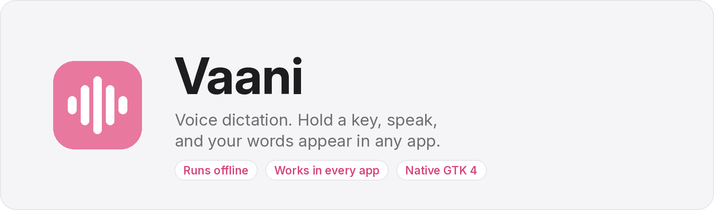
  </picture>
</p>

<p align="center">
  <a href="https://github.com/sakshamm21/vaani/actions/workflows/ci.yml"></a>
  
  
  <a href="LICENSE"></a>
</p>

<p align="center">
  <b>Hold a key, speak, let go.</b> Your words are typed into whatever app you're using:<br>
  a browser, an editor, a chat window or a terminal. Speech recognition runs on your own<br>
  computer by default, so your voice never leaves it.
</p>

<p align="center">
  <a href="https://github.com/sakshamm21/Vaani/releases/latest"></a>
  &nbsp;
  <a href="https://github.com/sakshamm21/Vaani/releases/latest"></a>
</p>

<p align="center">
  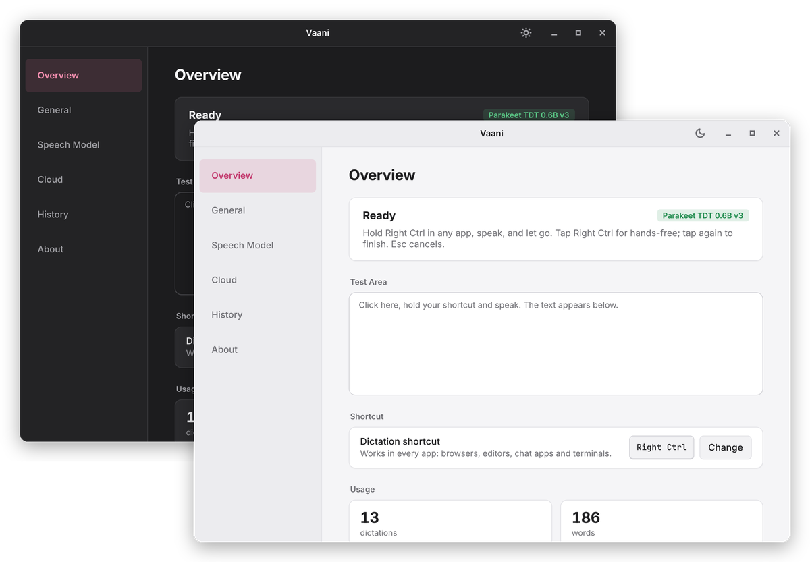
</p>

## See it in action

<p align="center">
  <picture>
    <source media="(prefers-color-scheme: dark)" srcset="assets/readme/demo-dark.gif">
    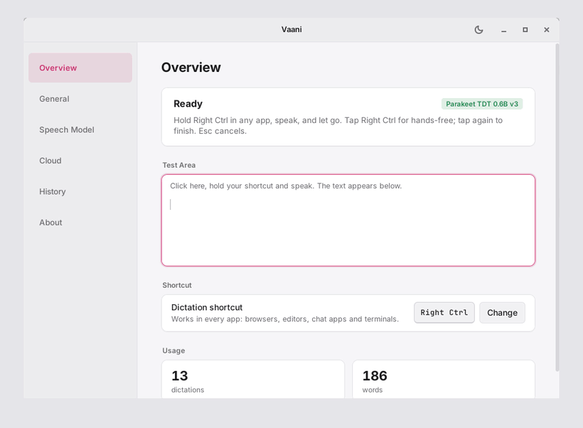
  </picture>
  <br>
  <sub>Hold <b>Right Ctrl</b>, speak, release. The pill shows your voice level, then the text appears where your cursor is.</sub>
</p>

## Features

- **Works in any app.** Text goes into whatever has focus: browsers, editors, chat apps,
  terminals, LibreOffice and Wine programs.
- **Local by default.** Twelve offline models through [sherpa-onnx](https://github.com/k2-fsa/sherpa-onnx)
  (Parakeet, Whisper, Moonshine, SenseVoice). No account, no server, no telemetry.
- **Bring your own key.** Optional cloud recognition with Groq, OpenAI, Deepgram, ElevenLabs,
  AssemblyAI, Sarvam or any OpenAI-compatible server. Keys live in the system keyring.
- **Live preview.** The words appear above the recording pill while you speak.
- **Text tools.** Filler-word removal, spoken punctuation, replacements, snippets, optional
  AI clean-up, command mode for rewriting a selection, and per-app rules.
- **Linux and Windows.** X11 and Wayland (GNOME, KDE Plasma, Hyprland, sway, Cinnamon and
  others), and Windows 10 and 11.
- **Native and light.** Rust and GTK 4. About 115 MB of memory and no CPU when idle; the
  default model adds about 850 MB.

<p align="center">
  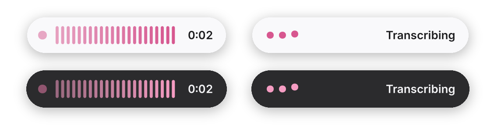
  <br>
  <sub>The recording indicator: listening (left) and transcribing (right).</sub>
</p>

## Contents

1. [Installation](#installation)
2. [Usage](#usage)
3. [Architecture](#architecture)
4. [Platform support](#platform-support)
5. [Speech engines](#speech-engines)
6. [Text processing](#text-processing)
7. [Configuration](#configuration)
8. [Command line](#command-line)
9. [Files and privacy](#files-and-privacy)
10. [Troubleshooting](#troubleshooting)
11. [Development](#development)
12. [Roadmap](#roadmap)
13. [License](#license)

## Installation

### Requirements

| | |
| --- | --- |
| System | Linux on x86-64 with X11 or Wayland, or Windows 10 (1809 or later) or 11 on x64 |
| Linux packages for | Debian 12, Ubuntu 22.04+, Linux Mint 21+, Pop!_OS, Fedora, openSUSE Tumbleweed and Leap 15.6, Arch |
| Memory | About 1 GB free with the default model; 115 MB with a cloud engine |
| Disk | 46 MB for the app on Linux, about 150 MB on Windows, plus 100 MB to 1.9 GB per model |
| Other | A microphone; internet for the first model download |

### Windows

Download `vaani-0.5.0-windows-x64-setup.exe` from the
[latest release](https://github.com/sakshamm21/Vaani/releases/latest) and run it. It installs
for your user only, so it needs no administrator rights, and adds Vaani to the Start menu.

The installer is not code-signed yet, so Windows SmartScreen may say it "protected your PC".
Click **More info**, then **Run anyway**. `SHA256SUMS-windows` lists the checksum of each file.

Then start **Vaani** from the Start menu and hold **Right Ctrl**. To uninstall, use
**Settings → Apps → Installed apps → Vaani**; it asks whether to keep your settings, history
and models.

For a portable copy, unpack `vaani-0.5.0-windows-x64-portable.zip` anywhere and run
`bin\vaani.exe`.

### Linux packages

Download the package for your distribution from the
[latest release](https://github.com/sakshamm21/Vaani/releases/latest) and install it:

```sh
sudo apt install ./vaani_0.5.0_amd64.deb                                 # Debian, Ubuntu, Mint, Pop!_OS
sudo dnf install ./vaani-0.5.0-1.x86_64.rpm                              # Fedora
sudo zypper install --allow-unsigned-rpm ./vaani-0.5.0-1.x86_64.rpm      # openSUSE
```

On Arch, build the `vaani-bin` package from the release's `PKGBUILD`:

```sh
mkdir vaani-bin && cd vaani-bin
curl -LO https://github.com/sakshamm21/Vaani/releases/latest/download/PKGBUILD
curl -LO https://github.com/sakshamm21/Vaani/releases/latest/download/vaani-bin.install
makepkg -si
```

Then start **Vaani** from the app menu (or run `vaani settings`) and hold **Right Ctrl**.

The packages set everything up, Wayland included: nothing to add to a group, no desktop
setting to change, no need to log out or restart. On GNOME and KDE Plasma the desktop asks
once to confirm Vaani's shortcut.

Other distributions can use `vaani-0.5.0-x86_64-linux.tar.gz`: unpack it and run
`./install.sh` to install under `~/.local` (it needs GTK 4 and ALSA). `SHA256SUMS` lists the
checksum of every file.

### From source (Linux)

```sh
git clone https://github.com/sakshamm21/Vaani.git
cd Vaani
./scripts/install.sh
```

The script installs the build dependencies (`apt`, `dnf`, `pacman` or `zypper`), installs Rust
through [rustup](https://rustup.rs) if needed, builds a release build, installs `vaani` and
`vaani-worker` to `~/.local/bin` with the menu entry, icon and fonts, adds the uinput udev rule
when Wayland needs it, and starts Vaani. `./scripts/install.sh --uninstall` removes it.

## Usage

On first start Vaani opens a setup page: download the default model (Parakeet TDT 0.6B v3,
465 MB) or add a cloud key, then try the shortcut, microphone and typing. Vaani then runs in
the background with a tray icon and starts at login (**General → Start Vaani when I log in**).

| Action | Result |
| --- | --- |
| Hold **Right Ctrl**, speak, release | Records while held, then inserts the text |
| Tap **Right Ctrl**, speak, tap again | Hands-free; optionally finishes after 3, 5 or 10 s of silence |
| **Esc** while recording | Cancels |
| Tray → **Paste last** | Inserts the most recent dictation again |
| Tray → **Speech engine** | Switches between downloaded models and the cloud engine |
| Tray → **Settings** | Opens the settings window |

Recordings are limited to five minutes. Every dictation is saved to History before it is
inserted, so nothing is lost if an app refuses the text.

## Architecture

Vaani is a Cargo workspace of small crates. One background process (`vaani run`) owns the
shortcut, microphone, clipboard and user interface; speech recognition runs in a supervised
child process; the command line and other tools talk to the running instance over D-Bus on
Linux and a named pipe on Windows.

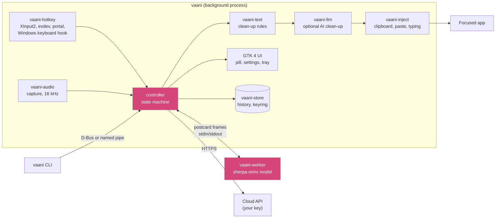

### One dictation

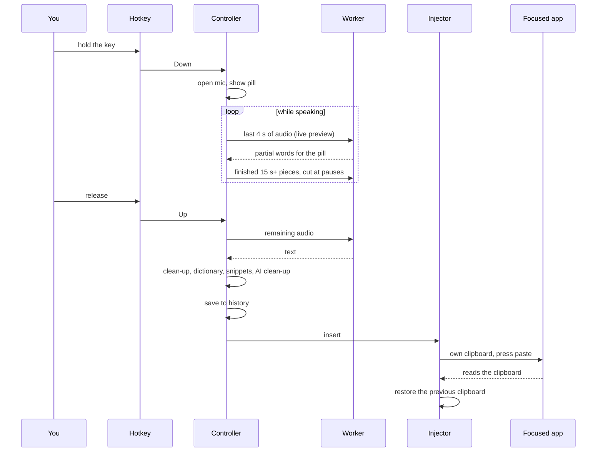

- **Worker process.** `vaani-worker` loads the model once and keeps it in memory. Requests and
  replies are length-prefixed `postcard` frames over its stdin and stdout. A crash or an
  out-of-memory kill only takes down the worker; the next request restarts it.
- **Long dictations.** Past 15 seconds, finished pieces are transcribed at natural pauses while
  you keep talking, so the wait after release stays short however long you speak.
- **Live preview.** Every ~0.6 s the local model re-reads the last four seconds and the reads
  are stitched into one caption. With a cloud engine, a separate local worker draws the
  preview so the cloud result is never delayed.
- **Insertion.** Vaani puts the text on the clipboard, presses the app's paste key, watches for
  the app to read it, then restores your clipboard. If the app ignores the paste, the text is
  typed key by key. Terminals get Ctrl+Shift+V; unknown apps get Shift+Insert. On Windows the
  clipboard is offered with delayed rendering, so Vaani knows the moment the app reads it, and
  the text is kept out of clipboard history.
- **Fallbacks.** A dictation made while the model loads waits for it; a failed cloud request
  falls back to an installed local model; anything that can't be inserted stays on the
  clipboard and in History.
- **State machine.** `vaani-core` drives Idle → Recording → Processing → Idle; Esc cancels
  from any state. Config changes are picked up live through a file watcher.

### Crates

| Crate | Role |
| --- | --- |
| `vaani-app` | The `vaani` binary: controller, GTK 4 pill and settings, tray (StatusNotifierItem or notification area), D-Bus or named-pipe service, CLI |
| `vaani-worker` | Speech recognition process (sherpa-onnx) |
| `vaani-stt` | Engine interface, worker client and protocol, cloud providers |
| `vaani-audio` | Microphone capture (cpal), resampling to 16 kHz (rubato), sound cues |
| `vaani-hotkey` | Global shortcut: X11 XInput2, evdev, GlobalShortcuts portal, Hyprland binding, Windows low-level keyboard hook |
| `vaani-inject` | Text insertion: X11 selections and XTest; Wayland data-control and uinput; Windows clipboard and SendInput |
| `vaani-text` | Rule-based clean-up, spoken commands, replacements, snippets, Hindi transliteration |
| `vaani-llm` | Optional AI clean-up and command mode, with output guardrails |
| `vaani-store` | History (SQLite) and API keys (Secret Service or Windows Credential Manager) |
| `vaani-models` | Model catalogue (`models/registry.toml`), downloads and checksums |
| `vaani-core` | Configuration schema and migration, state machine, paths |
| `vaani-platform` | Session, desktop and capability detection |

## Platform support

| | Shortcut | Text insertion | Pill |
| --- | --- | --- | --- |
| **X11** (any desktop) | XInput2 raw key events; any supported key | CLIPBOARD/PRIMARY ownership and XTest paste key | Override-redirect window |
| **GNOME** (Wayland) | GlobalShortcuts portal, Ctrl+Alt+Space by default | XWayland clipboard, paste key through `/dev/uinput` | Through XWayland |
| **KDE Plasma 6** | GlobalShortcuts portal, Ctrl+Alt+Space by default | ext data-control clipboard, `/dev/uinput` paste key | Through XWayland |
| **Hyprland** | Portal shortcut bound by Vaani through Hyprland's socket; Right Ctrl by default | wlr data-control clipboard, `/dev/uinput` paste key | Through XWayland |
| **sway** | `input` group (evdev) or `bindsym … exec vaani toggle` | wlr data-control clipboard, `/dev/uinput` paste key | Through XWayland |
| **Windows 10 and 11** | Low-level keyboard hook; any supported key | Delayed-render clipboard and `SendInput` paste key | Topmost tool window that never takes focus |

On Windows nothing needs setting up. An app running as administrator can't receive keys from
a normal app, so to dictate into one, run Vaani as administrator too.

On every Wayland desktop, joining the `input` group (`sudo usermod -aG input $USER`, then log
in again) lets Vaani read the keyboard directly, so any key works, including a lone Right Ctrl.
The portal can't watch Esc without taking it from every app, so with the portal, cancel from
the pill or the tray.

The packages install a udev rule that gives the logged-in user `/dev/uinput`, the same rule
Steam ships. If `vaani doctor` says `/dev/uinput` can't be opened, add it by hand:

```sh
echo 'KERNEL=="uinput", SUBSYSTEM=="misc", TAG+="uaccess", OPTIONS+="static_node=uinput"' |
  sudo tee /etc/udev/rules.d/70-vaani-uinput.rules
sudo modprobe uinput && sudo udevadm trigger --subsystem-match=misc --action=change
```

## Speech engines

### Local models

| Model | Download | Languages | Notes |
| --- | --- | --- | --- |
| Parakeet TDT 0.6B v3 | 465 MB | English and 24 European languages | Default |
| Parakeet TDT 0.6B v2 | 460 MB | English | |
| Moonshine Tiny | 103 MB | English | Fastest; for older machines |
| Moonshine Base | 240 MB | English | |
| Whisper Tiny | 111 MB | 99 languages | Includes Hindi |
| Whisper Base | 198 MB | 99 languages | |
| Whisper Small | 610 MB | 99 languages | |
| Whisper Large v3 Turbo | 538 MB | 99 languages | |
| Distil-Whisper Large v3.5 | 504 MB | English | |
| Whisper Medium | 1842 MB | 99 languages | Slow on CPU |
| Whisper Large v3 | 1019 MB | 99 languages | Slow on CPU |
| SenseVoice Small | 155 MB | Chinese, English, Japanese, Korean, Cantonese | |

Manage them on the **Speech Model** page or with `vaani models`. The catalogue lives in
[`models/registry.toml`](models/registry.toml) (URL, size and SHA-256 per model), so adding a
model is a data change.

### Cloud providers

| Provider | Default model | Notes |
| --- | --- | --- |
| Groq | `whisper-large-v3-turbo` | Free tier available |
| OpenAI | `gpt-4o-mini-transcribe` | |
| Deepgram | `nova-3` | |
| ElevenLabs | `scribe_v1` | |
| AssemblyAI | `universal` | Upload, then transcribe; slower |
| Sarvam | `saarika:v2.5` | Hindi and other Indian languages |
| OpenAI-compatible | set by you | Any `/v1/audio/transcriptions` server, such as a local faster-whisper |

Add a key on the **Cloud** page. Keys are stored through the Secret Service API (GNOME Keyring,
KWallet) on Linux and in Windows Credential Manager, and never written to the config file.
**Keep everything on this computer** turns cloud recognition off entirely.

## Text processing

Raw model output goes through these steps before it is inserted:

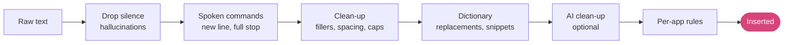

- **Spoken commands:** "new line", "new paragraph", "full stop", "comma", "question mark",
  and "scratch that" (removes the previous dictation from the last 10 minutes).
- **Dictionary:** replacements for words the model gets wrong, and snippets that expand a
  spoken phrase, with `{date}`, `{time}` and `{clipboard}` variables. Correcting a word in
  History offers to add it.
- **AI clean-up** (off by default): a language model fixes punctuation, repeats and
  self-corrections ("at 3, actually 4" becomes "at 4"). Providers: Groq, OpenAI, Anthropic,
  Ollama (local) or any OpenAI-compatible server. Replies that answer instead of transcribe,
  or that change too many words, are discarded; a 2.5 s limit keeps it from slowing you down.
- **Command mode:** select text, hold the command key and say "make this more formal" or
  "turn this into a list"; the selection is rewritten in place.
- **Per-app rules:** `[[apps]]` entries in the config file change the style, insertion method
  or trailing space for an app id:

```toml
[[apps]]
app = "slack"
style = "casual"        # clean, formal, casual, or "off" for no AI clean-up

[[apps]]
app = "code"
style = "off"
insert = "type"         # auto, paste or type
```

## Configuration

Settings are in `~/.config/vaani/config.toml` and are applied as soon as the file changes,
whether from the settings window or a text editor.

<table>
  <tr>
    <td width="50%">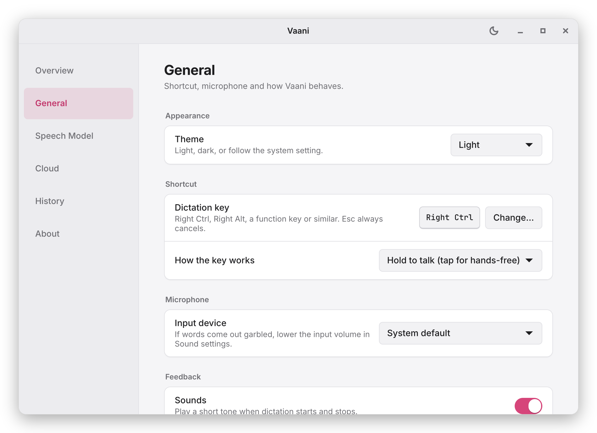</td>
    <td width="50%">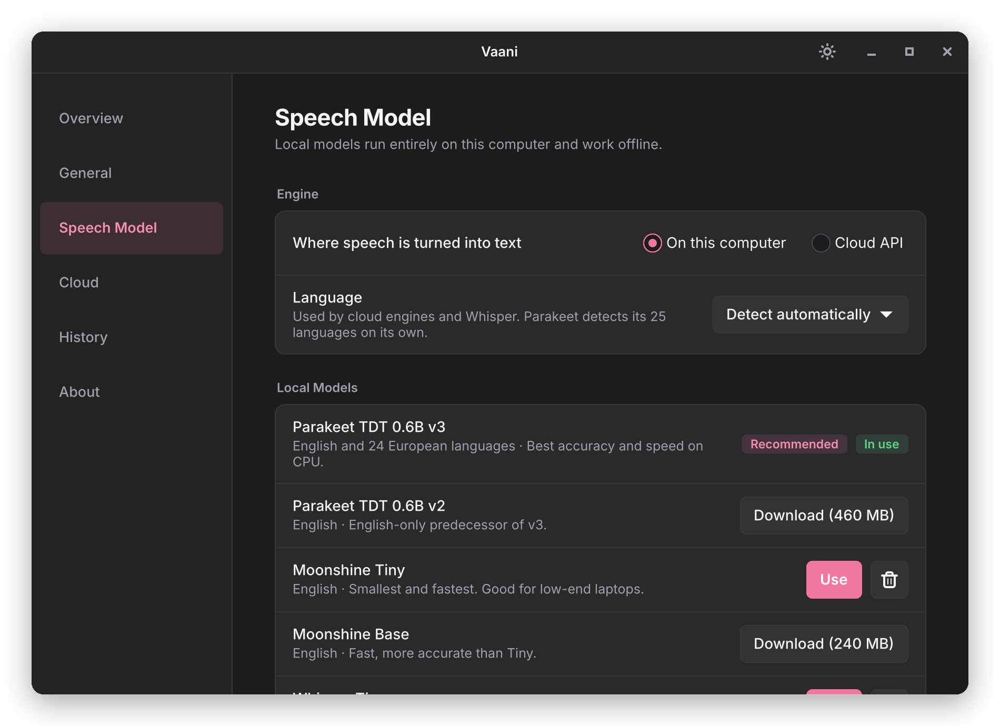</td>
  </tr>
  <tr>
    <td align="center"><sub><b>General</b>: theme, shortcut, microphone, sounds and history</sub></td>
    <td align="center"><sub><b>Speech Model</b>: pick and download local models</sub></td>
  </tr>
  <tr>
    <td width="50%">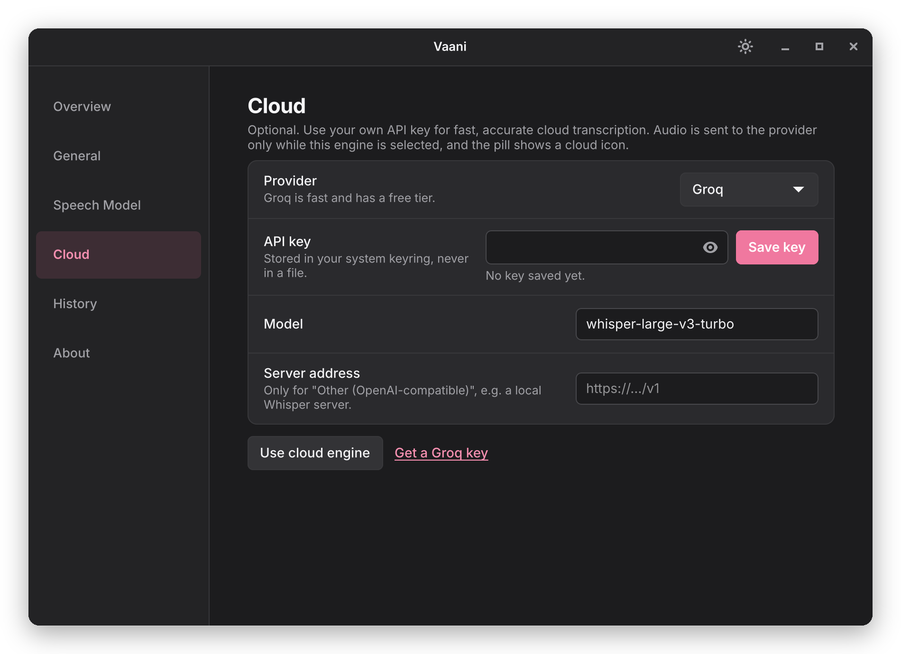</td>
    <td width="50%">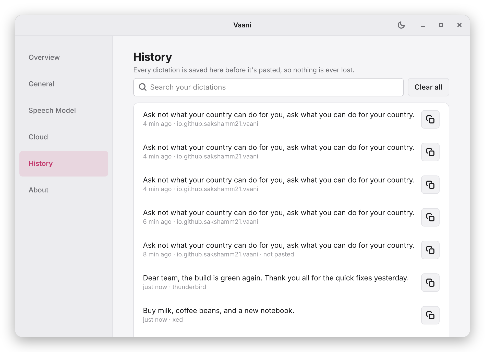</td>
  </tr>
  <tr>
    <td align="center"><sub><b>Cloud</b>: your own API key for Groq, OpenAI or a compatible server</sub></td>
    <td align="center"><sub><b>History</b>: search, copy, or clear past dictations</sub></td>
  </tr>
</table>

| Page | What it sets |
| --- | --- |
| General | Theme, dictation and command keys, hold or toggle, microphone, sounds, pill, live preview, filler removal, silence stop, media pausing, autostart, history size |
| Speech Model | Local or cloud engine, language, Hindi script (Devanagari or Latin), downloaded models, local-only mode |
| Cloud | Provider, API key, model, endpoint |
| Dictionary | Spoken commands, replacements, snippets |
| AI Clean-up | Provider, key, model, tone, extra instruction, full prompt, time limit |
| History | Search, copy, edit and clear past dictations |

## Command line

| Command | Description |
| --- | --- |
| `vaani` / `vaani run` | Start Vaani (one instance at a time) |
| `vaani settings` | Open the settings window |
| `vaani toggle` / `start` / `stop` / `cancel` | Control a dictation; `toggle` can be bound to any desktop shortcut |
| `vaani command` | Start or finish a command-mode dictation |
| `vaani status` | Print the state and engine |
| `vaani paste-last` | Insert the last dictation again |
| `vaani history [count]` | Print recent dictations |
| `vaani models [download <id> [--use] \| remove <id>]` | Manage local models |
| `vaani cleanup "<text>"` | Try AI clean-up with your settings |
| `vaani doctor [--json]` | Diagnostic report for bug reports |
| `vaani quit` | Stop Vaani |

## Files and privacy

| Path | Contents |
| --- | --- |
| `~/.config/vaani/config.toml` | Settings |
| `~/.local/share/vaani/models/` | Downloaded models |
| `~/.local/share/vaani/history.db` | History (SQLite), last 20 by default |
| `~/.local/state/vaani/logs/` | Logs, kept for seven days; no transcript text at the default level |
| `~/.config/autostart/io.github.sakshamm21.Vaani.desktop` | Autostart entry |

On Windows, settings are in `%APPDATA%\sakshamm21\vaani\config\`; models, history and logs
in `%LOCALAPPDATA%\sakshamm21\vaani\data\`; the autostart entry is the `Vaani` value under
`HKCU\Software\Microsoft\Windows\CurrentVersion\Run`.

No accounts, analytics or telemetry. With a local model, the only network requests are model
downloads from the [sherpa-onnx releases](https://github.com/k2-fsa/sherpa-onnx/releases).
Audio is kept in memory and never written to disk. Cloud recognition sends audio, and AI
clean-up sends text, only to the provider you chose.

## Troubleshooting

Run `vaani doctor` first. It reports the session, desktop, microphone, shortcut, model and
text-insertion status; include it in bug reports.

| Problem | What to do |
| --- | --- |
| Nothing happens on the key | Check `vaani status`. Another app may use the key; pick another under **General**. On Wayland, see [Platform support](#platform-support). |
| Text not inserted in one app | It is on the clipboard and in History; press Ctrl+V. Please open an issue naming the app, with `vaani doctor` output. |
| Poor or empty transcription | Pick the right microphone under **General**; lower the input volume if it clips; for other languages, use Whisper with the language set. |
| First dictation is slow | The model takes 3 to 6 s to load at start; dictations made meanwhile wait for it. |
| No tray icon | The desktop needs a StatusNotifierItem host; on GNOME, the AppIndicator extension. On Windows, look under the taskbar's **^** overflow arrow. Use `vaani settings` meanwhile. |

For detailed logs: `vaani quit`, then `VAANI_LOG=debug vaani run` (on Windows, in PowerShell:
`$env:VAANI_LOG="debug"; vaani run`).

## Development

Build dependencies, which `./scripts/install.sh` installs for you:

```sh
sudo apt install build-essential pkg-config clang cmake libasound2-dev libgtk-4-dev \
  libx11-dev libxi-dev libxtst-dev libxcb1-dev libxkbcommon-dev                 # Debian, Ubuntu
sudo dnf install gcc gcc-c++ make pkgconf clang cmake alsa-lib-devel gtk4-devel \
  libX11-devel libXi-devel libXtst-devel libxcb-devel libxkbcommon-devel        # Fedora
sudo pacman -S --needed base-devel pkgconf clang cmake alsa-lib gtk4 libx11 libxi libxtst \
  libxcb libxkbcommon                                                           # Arch
sudo zypper install gcc gcc-c++ make pkgconf clang cmake alsa-devel gtk4-devel libX11-devel \
  libXi-devel libXtst-devel libxcb-devel libxkbcommon-devel                     # openSUSE
```

Rust 1.85 or later. Build and run:

```sh
cargo build --release
./target/release/vaani run
```

The sherpa-onnx build script downloads a prebuilt static library on the first build; to build
offline, set `SHERPA_ONNX_ARCHIVE_DIR` to a directory holding that archive.

**Checks.** CI runs these on every push; run them before opening a pull request:

```sh
cargo fmt --all --check
cargo clippy --workspace --all-targets -- -D warnings
cargo test --workspace
```

**Packaging.** `scripts/package.sh` builds the `.deb`, `.rpm`, tarball, `PKGBUILD` and
`SHA256SUMS` into `dist/`. CI builds them on Ubuntu 22.04 (for the oldest supported glibc),
installs each one in Debian, Ubuntu, Fedora, openSUSE and Arch containers, and runs the
source install script on Fedora, Arch and Tumbleweed.

**Windows.** Build with the MSVC toolchain and the [gvsbuild](https://github.com/wingtk/gvsbuild)
GTK 4 bundle: unpack it, put its `bin` on `PATH`, point `PKG_CONFIG_PATH` at its
`lib\pkgconfig`, and run `cargo build --release`. `scripts/package-windows.ps1` gathers the
GTK DLLs, icons and pixbuf loaders, then builds the portable zip and the Inno Setup installer
(`packaging/windows/vaani.iss`). CI does this on `windows-latest` and runs
`scripts/windows-smoke-test.ps1`: a silent install, a dictation of a recorded sentence into
Notepad with Right Ctrl, the command line, and a silent uninstall.

Pushing a `v*` tag builds every package and creates one draft release with the Linux and
Windows files.

**Contributing.** Issues and pull requests are welcome; for larger changes, open an issue
first. Keep changes covered by the checks above.

## Roadmap

- Code-signed Windows installer
- Flatpak and AppImage packages

## License

Vaani is released under the [MIT License](LICENSE). The bundled Inter font is under the SIL
Open Font License 1.1 ([assets/fonts/OFL-Inter.txt](assets/fonts/OFL-Inter.txt)).
