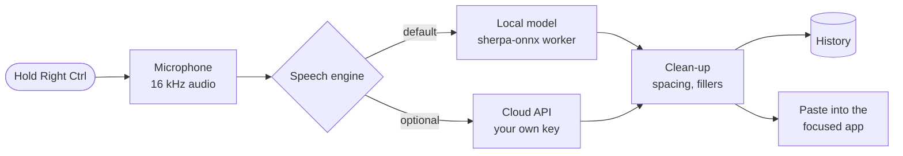

<p align="center">
  <picture>
    <source media="(prefers-color-scheme: dark)" srcset="assets/readme/banner-dark.png">
    
  </picture>
</p>

<p align="center">
  <a href="https://github.com/sakshamm21/vaani/actions/workflows/ci.yml"></a>
  
  
  <a href="LICENSE"></a>
</p>

<p align="center">
  <b>Hold a key, speak, let go.</b> Your words are typed into whatever app you're using:<br>
  a browser, an editor, a chat window or a terminal. Speech recognition runs on your own<br>
  computer by default, so your voice never leaves it.
</p>

<p align="center">
  
</p>

## See it in action

<p align="center">
  <picture>
    <source media="(prefers-color-scheme: dark)" srcset="assets/readme/demo-dark.gif">
    
  </picture>
  <br>
  <sub>Hold <b>Right Ctrl</b>, speak, release. The pill shows your voice level, then the text appears where your cursor is.</sub>
</p>

## Highlights

| | |
| --- | --- |
| **Works in every app** | Text goes into whatever has focus. Tested in Firefox, Chrome, LibreOffice Writer, Xed, Nextpad++, GNOME Terminal, Xfce Terminal and Wine Notepad. |
| **Private by default** | Twelve local speech models through [sherpa-onnx](https://github.com/k2-fsa/sherpa-onnx): Parakeet, Whisper, Moonshine and SenseVoice. No account, no telemetry. |
| **Fast cloud option** | Bring your own key for Groq, OpenAI, Deepgram, ElevenLabs, AssemblyAI, Sarvam or any OpenAI-compatible server. Keys live in your system keyring. |
| **Never loses a word** | If the model is still loading, Vaani waits for it. If an app ignores the paste, the text is typed instead. If the cloud is unreachable, an installed local model takes over. |
| **AI clean-up (optional)** | A language model fixes punctuation, repeated words and self-corrections ("at 3, actually 4" becomes "at 4"). Groq, OpenAI, Anthropic, Ollama or any compatible server. Off by default. |
| **Spoken commands** | Say "new line", "full stop" or "scratch that". Save snippets and word replacements in the Dictionary. |
| **Command mode** | Select text, hold the command key and say "make this more formal" or "turn this into a list". The selection is rewritten in place. |
| **Per-app rules** | A casual tone in Slack, a formal one in your mail client, no AI clean-up in your editor. |
| **Two ways to talk** | Hold the key to talk, or tap once for hands-free and tap again to finish. Esc cancels. |
| **Light and dark** | Follows your desktop theme, or set it yourself from the title bar. |
| **Lightweight** | Native GTK 4, no browser engine. The app uses 115 MB of memory and 0% CPU when idle; the default model adds 850 MB. |

<p align="center">
  
  <br>
  <sub>The recording indicator: listening (left) and transcribing (right).</sub>
</p>

## How it works



Vaani runs as a small background process with a tray icon. The speech model runs in a separate
worker process, so a model crash never takes the app down, and the model stays loaded between
dictations for quick results. Text is inserted through the clipboard with a paste shortcut, and
your previous clipboard is restored afterwards.

## Contents

1. [Requirements](#requirements)
2. [Installation](#installation)
3. [First run](#first-run)
4. [Using Vaani](#using-vaani)
5. [Wayland](#wayland)
6. [Settings](#settings)
7. [Speech models](#speech-models)
8. [Cloud providers](#cloud-providers)
9. [Command line](#command-line)
10. [Files and privacy](#files-and-privacy)
11. [Troubleshooting](#troubleshooting)
12. [Updating and uninstalling](#updating-and-uninstalling)
13. [Building from source](#building-from-source)
14. [Project layout](#project-layout)
15. [Roadmap](#roadmap)
16. [License](#license)

## Requirements

| | |
| --- | --- |
| Display server | X11 (Xorg) or Wayland. See [Wayland](#wayland) for what differs. |
| Distributions | Packages for Debian 12, Ubuntu 22.04 or later, Linux Mint 21 or later, Pop!_OS, Fedora, openSUSE Tumbleweed and Leap 15.6, and Arch. Elsewhere, use the tarball or build from source. |
| Desktop | Any desktop. Developed on Cinnamon (Linux Mint 22.3), tested on GNOME 50 (Ubuntu 26.04) and sway. A system tray is optional. |
| Memory | 1 GB free with the default model (Parakeet v3). Smaller models use less. With a cloud engine, 115 MB. |
| Disk | 46 MB for the app, plus 100 MB to 1.9 GB per model. Building from source needs 2 GB more. |
| Other | A microphone, and an internet connection for the first model download. |

To check your session type, run `echo $XDG_SESSION_TYPE`. It prints `x11` or `wayland`.

## Installation

### From a release package

Download `vaani_0.3.0_amd64.deb` from the [latest release](https://github.com/sakshamm21/Vaani/releases/latest)
and install it:

```sh
sudo apt install ./vaani_0.3.0_amd64.deb
vaani settings
```

On Fedora and openSUSE, download `vaani-0.3.0-1.x86_64.rpm` and install it:

```sh
sudo dnf install ./vaani-0.3.0-1.x86_64.rpm                              # Fedora
sudo zypper install --allow-unsigned-rpm ./vaani-0.3.0-1.x86_64.rpm      # openSUSE
```

On Arch, the release's `PKGBUILD` builds the `vaani-bin` package from the tarball:

```sh
mkdir vaani-bin && cd vaani-bin
curl -LO https://github.com/sakshamm21/Vaani/releases/latest/download/PKGBUILD
makepkg -si
```

For any other distribution, `vaani-0.3.0-x86_64-linux.tar.gz` holds the binaries. Unpack it and
run `./install.sh` to install under `~/.local` (`./install.sh --uninstall` removes it); it needs
GTK 4 and ALSA from your distribution. `SHA256SUMS` lists the checksums of every file.

### From source

```sh
git clone https://github.com/sakshamm21/Vaani.git
cd Vaani
./scripts/install.sh
```

The install script:

1. Installs the build dependencies with `apt`, `dnf`, `pacman` or `zypper` if any are
   missing. This, and the Wayland rule in step 5, are the only steps that ask for your password.
2. Installs the Rust toolchain through [rustup](https://rustup.rs) if `cargo` is not found.
   It is installed for your user only.
3. Builds Vaani in release mode. The first build compiles every dependency and takes several minutes; later builds are quick.
4. Installs `vaani` and `vaani-worker` to `~/.local/bin`, the application icon and menu entry
   to `~/.local/share`, and the interface fonts to `~/.local/share/fonts/vaani`.
5. If `/dev/uinput` is not writable, adds a udev rule (`/etc/udev/rules.d/70-vaani-uinput.rules`)
   so Vaani can press the paste key on Wayland. Steam and other input tools ship the same rule.
6. Starts Vaani.

Nothing else is installed system-wide.

If `~/.local/bin` is not on your `PATH`, the script prints a notice. Ubuntu, Mint and Debian
add it at your next login. Until then, start Vaani from the application menu.

### Manual dependency installation

On Debian, Ubuntu and Mint the script installs these packages for you:

```sh
sudo apt install build-essential pkg-config clang cmake libasound2-dev libgtk-4-dev \
  libx11-dev libxi-dev libxtst-dev libxcb1-dev libxkbcommon-dev
```

On Fedora:

```sh
sudo dnf install gcc gcc-c++ make pkgconf clang cmake alsa-lib-devel gtk4-devel \
  libX11-devel libXi-devel libXtst-devel libxcb-devel libxkbcommon-devel
```

On Arch:

```sh
sudo pacman -S --needed base-devel pkgconf clang cmake alsa-lib gtk4 libx11 libxi libxtst \
  libxcb libxkbcommon
```

On openSUSE:

```sh
sudo zypper install gcc gcc-c++ make pkgconf clang cmake alsa-devel gtk4-devel libX11-devel \
  libXi-devel libXtst-devel libxcb-devel libxkbcommon-devel
```

## First run

When Vaani starts for the first time it opens a setup page with four checks. Each one turns
pink when it passes.

1. **Speech model.** Click **Download** to fetch the default model, Parakeet TDT 0.6B v3
   (465 MB). It loads as soon as the download finishes. To use Groq or OpenAI instead, click
   **Use a Cloud API Key Instead**.
2. **Shortcut.** Hold **Right Ctrl** for a moment.
3. **Microphone.** Say a few words while holding the key. If the check stays grey, pick a
   different microphone in the same row.
4. **Typing.** Click in the text box, hold the key and speak. Your words appear in the box.

Click **Start Using Vaani** to finish, or **Skip for Now**. The window then shows the
**Overview** page; close it and Vaani keeps running in the system tray.

Vaani adds itself to your desktop's startup applications, so it starts at every login. You
can turn this off under **General → Start Vaani when I log in**.

No additional permissions are required on X11. Vaani does not need to be in the `input` group
and does not use `sudo` at runtime. On Wayland, see [Wayland](#wayland).

## Using Vaani

| Action | Result |
| --- | --- |
| Hold **Right Ctrl**, speak, release | Records while the key is held, then inserts the text. |
| Tap **Right Ctrl**, speak, tap again | Hands-free: recording continues until the second tap. |
| **Esc** while recording | Cancels. Nothing is inserted. |
| Stop talking in hands-free mode | Optionally finishes on its own after 3, 5 or 10 seconds of silence. |
| Tray icon → **Paste last** | Inserts the most recent dictation again. |
| Tray icon → **Speech engine** | Switches between your downloaded models and the cloud engine. |
| Tray icon → **Pause history** | Stops saving new dictations until you turn it off again. |
| Tray icon → **Settings**, or Vaani in the application menu | Opens the settings window. |

While recording, an indicator at the bottom of the screen shows the input level and elapsed
time. If a cloud engine is active, the indicator says so. Music and videos that support
media controls (Spotify, browsers, most players) pause while you speak and resume afterwards.

### Spoken commands

| Say | Writes |
| --- | --- |
| "new line" / "next line" | A line break |
| "new paragraph" / "next paragraph" | A blank line |
| "full stop", "comma", "question mark", "exclamation mark", "colon", "semicolon" | The punctuation mark |
| "scratch that" / "delete that" (on its own) | Removes your previous dictation, if it was in the last 10 minutes |

Commands can be turned off under **Dictionary**. The same page holds:

- **Replacements**: a word or phrase the model writes, and what to write instead. Use it for
  names and brands the model misspells.
- **Snippets**: a phrase you say, and the text Vaani inserts for it, such as an address or an
  email sign-off. `{date}`, `{time}` and `{clipboard}` are filled in when the snippet is used.

Text is inserted by placing it on the clipboard and sending a paste shortcut to the focused
window (Ctrl+V, or Ctrl+Shift+V in terminals). Your previous clipboard contents are restored
afterwards. If the application does not take the paste, Vaani types the text key by key
instead, which also works in older and Wine applications. Each dictation is also saved to History before it is inserted, so text is not lost if an
application does not accept the paste. History keeps the last 20 dictations by default; this
can be changed, or turned off, under **General → History**.

Recordings are limited to five minutes. During a long dictation Vaani transcribes what you
have said so far at each pause, so the text appears shortly after you stop, however long you
spoke.

### AI clean-up

Off by default. When it is on, each dictation of four words or more is sent to a language
model that fixes punctuation, capitalisation, repeated words and spoken self-corrections. It
does not answer questions or follow instructions in what you say: if the reply is empty, cut
short, an answer instead of your words, or mostly new words, Vaani discards it and
inserts what you said. It is skipped in terminals and code editors.

| Provider | Default model | Notes |
| --- | --- | --- |
| Groq | `openai/gpt-oss-20b` | Uses the same key as Groq speech recognition. Free tier: 30 requests a minute. |
| OpenAI | `gpt-4o-mini` | |
| Anthropic | `claude-haiku-5-5` | |
| Ollama | `llama3.2:3b` | Runs on this computer; no key. Allowed when **Keep everything on this computer** is on. |
| OpenAI-compatible | set by you | Any server implementing `/v1/chat/completions` |

The **AI Clean-up** page sets the provider, key, model, tone (clean, formal or casual), an
extra instruction such as "British spelling", and the full prompt, and has a button to test it
on a sample sentence. If the model does not reply within the time limit (2.5 seconds by
default), the dictation is inserted as transcribed.

### Command mode

Pick a **Command key** under **General** (for example Right Alt). Select some text, hold the
command key and say what to do with it: "make this more formal", "fix the grammar", "translate
this to Hindi", "turn this into a bulleted list". The AI clean-up provider rewrites the
selection and Vaani pastes the result over it. With nothing selected, it writes what you ask
for ("write a short thank-you note to Priya"). Command mode works even when AI clean-up of
ordinary dictations is off, but it needs a provider and key set on the **AI Clean-up** page.
`vaani command` does the same from a shortcut of your own.

### Per-app rules

Add an `[[apps]]` entry to `~/.config/vaani/config.toml` for each app that should behave
differently. `app` is matched against the window's app id, ignoring case:

```toml
[[apps]]
app = "slack"
style = "casual"        # clean, formal, casual, or "off" for no AI clean-up

[[apps]]
app = "thunderbird"
style = "formal"

[[apps]]
app = "code"
style = "off"
insert = "type"         # auto, paste or type
trailing_space = false
```

The app id is the window class or Wayland app id, such as `firefox` or `org.gnome.TextEditor`.
Vaani's log (see [Troubleshooting](#troubleshooting)) names the app for each dictation.

## Wayland

Vaani works on Wayland desktops. A few things work differently from X11:

| | GNOME | KDE Plasma, Hyprland, sway and other wlroots desktops |
| --- | --- | --- |
| Shortcut | Through the desktop's shortcut portal. Vaani asks once to add a **Dictate** shortcut (Ctrl+Alt+Space by default); change it in **Settings → Keyboard → Shortcuts → Apps**. Hold to talk and tap for hands-free both work. | The same portal on KDE Plasma. On every desktop, Vaani reads the keyboard directly instead when you are in the `input` group, so any key works, including a lone Right Ctrl. |
| Inserting text | Clipboard through XWayland, paste key through a virtual keyboard (`/dev/uinput`). | The Wayland clipboard (data-control protocol), paste key through a virtual keyboard. |
| Recording pill | Shown through XWayland, above other windows. | The same. |

To hold any single key, as on X11, add yourself to the `input` group and log in again:

```sh
sudo usermod -aG input $USER
```

sway has no shortcut portal: there, join the `input` group, or bind `vaani toggle` in your sway
config (`bindsym $mod+d exec vaani toggle`).

The shortcut portal can't watch Esc without taking it from every app, so with the portal,
cancel a dictation from the pill or the tray instead.

The packages and the install script add a udev rule that lets you use `/dev/uinput`. If
`vaani doctor` says it can't open `/dev/uinput`, add the rule by hand:

```sh
echo 'KERNEL=="uinput", SUBSYSTEM=="misc", TAG+="uaccess", OPTIONS+="static_node=uinput"' |
  sudo tee /etc/udev/rules.d/70-vaani-uinput.rules
sudo udevadm trigger --subsystem-match=misc --action=change
```

When Vaani can't tell which app has focus (native Wayland apps on GNOME), it pastes with
Shift+Insert, which works in terminals and other apps alike. Per-app rules need the app id, so
on GNOME they apply to XWayland apps only.

## Settings

Open the settings window from the tray icon or the application menu. Changes are saved
immediately.

<table>
  <tr>
    <td width="50%"></td>
    <td width="50%"></td>
  </tr>
  <tr>
    <td align="center"><sub><b>General</b>: theme, shortcut, microphone, sounds and history</sub></td>
    <td align="center"><sub><b>Speech Model</b>: pick and download local models</sub></td>
  </tr>
  <tr>
    <td width="50%"></td>
    <td width="50%"></td>
  </tr>
  <tr>
    <td align="center"><sub><b>Cloud</b>: your own API key for Groq, OpenAI or a compatible server</sub></td>
    <td align="center"><sub><b>History</b>: search, copy, or clear past dictations</sub></td>
  </tr>
</table>

**General**

| Setting | Description |
| --- | --- |
| Theme | Light, dark, or follow the desktop. Also available from the button in the title bar. |
| Dictation key | Click **Change…** and press the key to use. Supported keys: Right Ctrl, Right Alt, Right Shift, Right Super, Left Ctrl, Left Alt, Super, Menu, Insert, Pause, Scroll Lock and F1 to F12. |
| How the key works | *Hold to talk* (tap for hands-free) or *Press to start, press to stop*. |
| Command key | Off by default. Hold it to change the selected text by voice; see [Command mode](#command-mode). |
| Input device | The microphone to record from. |
| Sounds | Short tones when recording starts and stops. |
| Floating pill | The on-screen recording indicator. |
| Show words while speaking | Shows the words above the pill as you speak, read on this computer by the downloaded local model (Parakeet, Moonshine or SenseVoice; not Whisper). With a cloud engine the local model only draws the preview and the cloud still writes the text. On by default. |
| Remove filler words | Removes "um", "uh" and similar words. |
| Add a space after each dictation | Separates consecutive dictations. |
| Finish hands-free on silence | Never (default), or after 3, 5 or 10 seconds without speech. |
| Pause music while dictating | Pauses media players while recording and resumes them afterwards. On by default. |
| Start Vaani when I log in | Adds or removes the autostart entry. |
| History | How many dictations to keep: none, the last 20 (default), 100 or 1,000, or all. Older entries are deleted automatically. |
| Pause history | New dictations are not saved while this is on. Also in the tray menu. |

**Speech Model** chooses between local and cloud recognition, sets the language, chooses
whether Hindi is written in Devanagari or in Latin letters ("aap kaise ho"), and manages
downloaded models. **Keep everything on this computer** turns cloud recognition off
entirely, so audio never leaves the machine.

**Dictionary** turns spoken commands on or off and manages replacements and snippets.

**Cloud** configures the provider, API key, model and endpoint for cloud recognition.

**AI Clean-up** configures the optional language-model pass; see [AI clean-up](#ai-clean-up).

**History** lists previous dictations with search, copy and edit. When you correct a word or
a short phrase (for example "vani" to "Vaani"), Vaani offers to add the fix to your
Dictionary, so it is written correctly from then on. **Clear all** deletes the list.

**Overview** shows lifetime totals: dictations, words, your speaking pace in words per minute,
and the time saved compared with typing at 40 words per minute.

**About** shows the version and links to the log, model and configuration folders, and copies
a diagnostic report for bug reports.

All settings are stored in `~/.config/vaani/config.toml`. The file can be edited by hand;
Vaani applies changes when the file is saved.

## Speech models

| Model | Download | Languages | Notes |
| --- | --- | --- | --- |
| Parakeet TDT 0.6B v3 | 465 MB | English and 24 European languages | Default. |
| Parakeet TDT 0.6B v2 | 460 MB | English | |
| Moonshine Tiny | 103 MB | English | Fastest. For older or low-memory machines. |
| Moonshine Base | 240 MB | English | |
| Whisper Tiny | 111 MB | 99 languages | Includes Hindi. |
| Whisper Base | 198 MB | 99 languages | |
| Whisper Small | 610 MB | 99 languages | |
| Whisper Large v3 Turbo | 538 MB | 99 languages | |
| Distil-Whisper Large v3.5 | 504 MB | English | |
| Whisper Medium | 1842 MB | 99 languages | Slow on CPU. |
| Whisper Large v3 | 1019 MB | 99 languages | Slow on CPU. |
| SenseVoice Small | 155 MB | Chinese, English, Japanese, Korean, Cantonese | |

Models are managed on the **Speech Model** page, where you can download, select and delete
them. They can also be managed with `vaani models`. Models are stored in
`~/.local/share/vaani/models`.

The active model stays loaded in a separate `vaani-worker` process so that transcription
starts immediately. The worker uses 850 MB with Parakeet v3; smaller models use less. If the worker crashes, Vaani restarts it.

For Whisper and the cloud engines, set the spoken language under **Speech Model → Language**,
or leave it on automatic detection. Parakeet detects its supported languages automatically.

## Cloud providers

| Provider | Default model | API key |
| --- | --- | --- |
| Groq | `whisper-large-v3-turbo` | [console.groq.com/keys](https://console.groq.com/keys) (free tier available) |
| OpenAI | `gpt-4o-mini-transcribe` | [platform.openai.com/api-keys](https://platform.openai.com/api-keys) |
| Deepgram | `nova-3` | [console.deepgram.com](https://console.deepgram.com/) |
| ElevenLabs | `scribe_v1` | [elevenlabs.io/app/settings/api-keys](https://elevenlabs.io/app/settings/api-keys) |
| AssemblyAI | `universal` | [assemblyai.com/app/api-keys](https://www.assemblyai.com/app/api-keys). Slower: the audio is uploaded, then transcribed. |
| Sarvam | `saarika:v2.5` | [dashboard.sarvam.ai](https://dashboard.sarvam.ai/). Hindi and other Indian languages. |
| OpenAI-compatible | set by you | Any server implementing `/v1/audio/transcriptions`, for example a local faster-whisper or whisper.cpp server |

To use a cloud provider:

1. Open **Cloud**, choose a provider, paste your API key and click **Save key**.
2. Click **Use cloud engine**, or select **Cloud API** on the **Speech Model** page.

API keys are stored in the system keyring (GNOME Keyring or KWallet, through the Secret
Service API). They are never written to the configuration file. Audio is sent to the provider
only while a cloud engine is selected.

## Command line

| Command | Description |
| --- | --- |
| `vaani` or `vaani run` | Start Vaani. Only one instance runs at a time. |
| `vaani settings` | Open the settings window, starting Vaani if needed. |
| `vaani toggle` | Start or finish a dictation. |
| `vaani start`, `vaani stop`, `vaani cancel` | Control a dictation. |
| `vaani status` | Print the current state and engine. |
| `vaani paste-last` | Insert the most recent dictation again. |
| `vaani command` | Start or finish a command-mode dictation for the selected text. |
| `vaani models` | List models and whether they are installed. |
| `vaani models download <id> [--use]` | Download a model, and optionally make it active. |
| `vaani models remove <id>` | Delete a downloaded model. |
| `vaani history [count]` | Print recent dictations. |
| `vaani doctor [--json]` | Print a diagnostic report. |
| `vaani cleanup "<text>"` | Run AI clean-up on the text with your current settings and print the result. `--file <path>` runs one line at a time; `--models` lists the provider's models. |
| `vaani quit` | Stop Vaani. |

`vaani toggle` can be bound to a key in your desktop's keyboard settings if you prefer a key
combination that Vaani's own shortcut does not support.

## Files and privacy

| Path | Contents |
| --- | --- |
| `~/.config/vaani/config.toml` | Settings |
| `~/.local/share/vaani/models/` | Downloaded models |
| `~/.local/share/vaani/history.db` | Dictation history (SQLite). Keeps the last 20 by default; see **General → History**. |
| `~/.local/state/vaani/logs/` | Logs, kept for seven days |
| `~/.config/autostart/io.github.sakshamm21.Vaani.desktop` | Autostart entry |

Vaani has no accounts, analytics or telemetry. With a local model it makes network requests
only to download models from the
[sherpa-onnx releases](https://github.com/k2-fsa/sherpa-onnx/releases) on GitHub. Audio
recordings are kept in memory only and are never written to disk. AI clean-up, when turned
on, sends the dictated text (not audio) to the chosen provider.

## Troubleshooting

Start with `vaani doctor`. It reports the session type, desktop, microphone, hotkey, model
and text-insertion status. Include its output in bug reports.

**Nothing happens when I press the key.**
Check that Vaani is running (`vaani status`). Another application may be using the same key;
choose a different key under **General → Dictation key**. On Wayland, see [Wayland](#wayland)
for which shortcut is in use.

**The text is not inserted into one application.**
Vaani pastes first and types the text key by key if the application does not take the paste.
If neither works, the text stays on the clipboard and in History; press Ctrl+V. Open an issue
with the application's name and the output of `vaani doctor`.

**The transcription is poor or empty.**
Make sure the right microphone is selected under **General → Input device**. If the level
bars stay flat, check your system sound settings. If the input is very loud, lower the input
volume in the sound settings, since clipping reduces accuracy. For languages other than
English, try a Whisper model and set the language explicitly.

**The first dictation is slow.**
The model loads when Vaani starts: 3 to 6 seconds for Parakeet on a four-core CPU, longer from
a hard disk. A dictation made during loading is kept, and the pill shows *Loading model* until
it can be transcribed.

**The tray icon is missing.**
Your desktop needs a StatusNotifierItem host. Cinnamon, KDE Plasma, MATE and Xfce include one;
GNOME needs the AppIndicator extension. Without a tray, open Vaani from the application menu or
with `vaani settings`.

**`vaani: command not found`.**
`~/.local/bin` is not on your `PATH` yet. Log out and back in, or run `~/.local/bin/vaani`.

**`vaani doctor` prints ALSA or JACK messages.**
The audio library prints them while it lists devices. They are harmless.

For more detail, start Vaani with debug logging and reproduce the problem:

```sh
vaani quit
VAANI_LOG=debug vaani run
```

## Updating and uninstalling

If you installed a package, install the new release's package the same way. Remove Vaani with
`sudo apt remove vaani`, `sudo dnf remove vaani`, `sudo zypper remove vaani` or
`sudo pacman -R vaani-bin`.

For a source install, pull the latest changes and run the install script again. Settings, history and
models are kept.

```sh
cd Vaani
git pull
./scripts/install.sh
```

To uninstall:

```sh
./scripts/install.sh --uninstall
```

This removes the binaries, menu entry, icon, fonts and autostart entry. To also remove your
settings, history and models:

```sh
rm -rf ~/.config/vaani ~/.local/share/vaani ~/.local/state/vaani
```

## Building from source

Requirements: Rust 1.85 or later and the dependencies listed under
[Manual dependency installation](#manual-dependency-installation).

```sh
cargo build --release
./target/release/vaani run
```

The sherpa-onnx build script downloads a prebuilt static library from GitHub on the first
build. To build offline, download the archive yourself and set `SHERPA_ONNX_ARCHIVE_DIR` to
the directory that contains it.

Before submitting changes, run the same checks as CI:

```sh
cargo fmt --all --check
cargo clippy --workspace --all-targets -- -D warnings
cargo test --workspace
```

Pull requests are welcome. For larger changes, open an issue first.

## Project layout

```
crates/
  vaani-app        The vaani binary: background service, tray, indicator, settings
                   window, D-Bus interface and command line
  vaani-worker     Speech recognition process (sherpa-onnx)
  vaani-audio      Microphone capture and resampling
  vaani-stt        Local and cloud recognition engines
  vaani-hotkey     Global shortcut (X11 XInput2, evdev, GlobalShortcuts portal)
  vaani-inject     Text insertion (X11 and Wayland clipboard, XTest and uinput keys)
  vaani-text       Text clean-up and Hindi transliteration
  vaani-llm        Optional AI clean-up (language-model providers and guardrails)
  vaani-store      History (SQLite) and API keys (Secret Service)
  vaani-models     Model catalogue and downloads
  vaani-core       Configuration, state machine and paths
  vaani-platform   Session and desktop detection
models/            Model catalogue (registry.toml)
assets/            Icons, desktop entry, udev rule, fonts and README images
scripts/           Install and packaging scripts
```

Vaani runs as a single background process that owns the shortcut, microphone, clipboard and
user interface. Speech recognition runs in `vaani-worker`, a child process, so that a model
failure cannot take down the main application. The command line talks to the running
instance over D-Bus (`io.github.sakshamm21.Vaani`).

## Roadmap

- Flatpak and AppImage packages.
- Windows.

## License

Vaani is released under the [MIT License](LICENSE). The bundled Inter font is under the SIL
Open Font License 1.1 ([assets/fonts/OFL-Inter.txt](assets/fonts/OFL-Inter.txt)).
